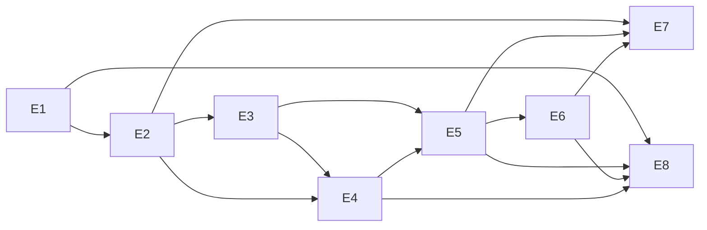

# Эпики Jira — Credit Journey MVP

> Термины: [epic](../glossary/terms.md#epic) · [backlog](../glossary/terms.md#backlog) · [MVP](../glossary/terms.md#mvp)

**Версия:** 1.0  
**Дата:** 2026-11-09  
**Согласовано:** Продуктовый отдел (нарезка [backlog](../glossary/terms.md#backlog)) при участии IT-отдела (feasibility) и Отдела QA (E8); Отдел кредитных рисков — consulted по E3/E4  
**Подготовил:** PM / BA  

**Опора:** [BRD](../brd/brd-credit-journey.md), [TO-BE](../processes/to-be-loan-journey.md), [Стейкхолдеры и RACI](../stakeholders-raci.md)  
**Назначение:** нарезка Epic для Jira с трассировкой на BR-xx.

Часть деталей уточнится после закрытия строк «Ожидает данных» в BRD (см. колонку «Ждёт» ниже).

---

## 1. Сводка [эпиков](../glossary/terms.md#epic)

| ID | Цель (кратко) | Порядок | Ключевые BR | Ждёт (BRD) | Jira Suggested name |
|----|---------------|---------|-------------|------------|---------------------|
| E1 | Заявка + гейт согласий | 1 | BR-01…05 | Q4 (тексты) | `CJ: Application & Consents` |
| E2 | [БКИ](../glossary/terms.md#bki) на критическом пути | 2 | BR-10, §7–9 | Q2 | `CJ: Credit Bureau Integration` |
| E3 | Правила [approve/decline](../glossary/terms.md#approve-decline)/MR | 3 | BR-10…12, 15 | Q3 | `CJ: Decision Rules Engine` |
| E4 | Очередь [manual review](../glossary/terms.md#manual-review) | 4 | BR-13…16 | Q3, Q6 | `CJ: Manual Review Queue` |
| E5 | [Оффер](../glossary/terms.md#offer) займа и выдача | 5 | BR-20…24 | Q6 | `CJ: Loan Offer & Disbursement` |
| E6 | Страхование [opt-in](../glossary/terms.md#opt-in) | 6 | BR-30…34 | Q4, Q5 | `CJ: Insurance Opt-in Offer` |
| E7 | Мониторинг и алерты | ∥ с E2–E6 | §11, BR-34 | Q2 | `CJ: Integration Monitoring` |
| E8 | [UAT](../glossary/terms.md#uat) и качество MVP | ∥ / закрытие на gate | §8, §12 | — | `CJ: UAT & MVP Quality Gate` |

`CJ` = Credit Journey (префикс для фильтра в Jira).

---

## 2. Принципы нарезки

- Эпик = **бизнес-capability / шаг [journey](../glossary/terms.md#journey)**, а не слой («только UI» / «только backend»).
- Каждый Must-BR из BRD покрыт ≥1 эпиком; Should (BR-16) — в E4 как метрика / follow-up.
- Зависимости явны: нельзя закрыть E5 без рабочего решения из E3/E4.
- В этом документе — **эпики + 1 пример story**; полный бэклог stories — отдельно (в т.ч. через интеграцию с Jira).
- Out of scope MVP (ML, своё МП, коллекшен, замена [АБС](../glossary/terms.md#abs), мульти-БКИ) в эпики не кладём.

---

## 3. Порядок поставки

```text
E1 Application & Consents
 → E2 Credit Bureau Integration
 → E3 Decision Rules Engine
 → E4 Manual Review Queue
 → E5 Loan Offer & Disbursement
 → E6 Insurance Opt-in Offer
 → E7 Integration Monitoring     (каркас параллельно с E2–E6)
 → E8 UAT & MVP Quality Gate     (чек-листы с середины; закрытие на UAT gate)
```

Параллель: после контрактов E2/E6 — работа по спецификациям обмена; E7 наращивать по мере появления интеграций; E8 — cross-cutting epic качества.

---

## 4. Эпики MVP

### E1 — Заявка и согласия

| | |
|--|--|
| **Jira** | Name: `CJ: Application & Consents` |
| **Цель** | Клиент создаёт заявку; без валидных согласий [ПДн](../glossary/terms.md#pdn)+БКИ путь дальше закрыт |
| **In** | Анкета в канале; гейт согласий; версия текстов; incomplete → дозапрос; запись заявки в АБС |
| **Out** | Правила скоринга; вызов БКИ; офферы |
| **BR** | BR-01 … BR-05 |
| **Ждёт** | Q4 — финальные тексты согласий (Комплаенс) |
| **Зависит от** | — (старт) |
| **[DoD](../glossary/terms.md#dor-dod) эпика** | Гейт согласий блокирует переход к БКИ; incomplete не вызывает БКИ; заявка создаётся в АБС |
| **Пример story** | Как клиент, я подтверждаю согласия ПДн и БКИ, иначе не могу отправить заявку на проверку |

### E2 — Интеграция БКИ

| | |
|--|--|
| **Jira** | Name: `CJ: Credit Bureau Integration` |
| **Цель** | Запрос КИ на критическом пути; таймауты/ретраи; передача результата в decision |
| **In** | Вызов БКИ API; политика retry/timeout (`[TBD]` из BRD §9); коды `MR_BKI_TIMEOUT` / `MR_BKI_ERROR`; запрет approve без актуального ответа БКИ |
| **Out** | Бизнес-правила approve/decline; UI оффера |
| **BR** | BR-10 (входные данные); §7–§9 BRD; fallback → MR |
| **Ждёт** | Q2 — timeout/retry/[SLA](../glossary/terms.md#sla) |
| **Зависит от** | E1 |
| **DoD эпика** | Успешный ответ БКИ передаётся в decision; после исчерпания ретраев — `manual_review` с кодом; нет auto-approve при ошибке/таймауте |
| **Пример story** | Как система, после N неуспешных попыток БКИ я перевожу заявку в `manual_review` с кодом `MR_BKI_TIMEOUT` |

### E3 — Правила решения (decision engine)

| | |
|--|--|
| **Jira** | Name: `CJ: Decision Rules Engine` |
| **Цель** | По ответу БКИ вынести `approve` / `decline` / `manual_review` с `reason_code` |
| **In** | Движок/конфиг правил Отдела кредитных рисков; справочник decline-кодов; экран/статус отказа клиенту |
| **Out** | Очередь оператора (E4); выдача денег |
| **BR** | BR-10, BR-11, BR-12, BR-15 (критерии MR — `[TBD]`) |
| **Ждёт** | Q3 — полный список правил → MR |
| **Зависит от** | E2 |
| **DoD эпика** | Три исхода авто-решения работают; decline пишет `reason_code` из baseline-справочника |
| **Пример story** | Как риск-правило, при стоп-факторе БКИ я фиксирую `DECLINE_BKI_NEGATIVE` и показываю клиенту отказ |

### E4 — Manual review

| | |
|--|--|
| **Jira** | Name: `CJ: Manual Review Queue` |
| **Цель** | Операционный отдел разбирает очередь MR; аудит решения; без approve без актуальной КИ / явного решения оператора |
| **In** | Очередь; UI/процесс оператора; approve/decline + аудит; регламент |
| **Out** | Авто-скоринг [Phase 2](../glossary/terms.md#phase-2); целевой % MR (BR-16 — Should / `[TBD]`) |
| **BR** | BR-13, BR-14, BR-15; частично BR-16 |
| **Ждёт** | Q3, Q6 |
| **Зависит от** | E3; E2 (технический MR) |
| **DoD эпика** | Оператор видит причину MR; решение аудируется; выдача из MR только после явного approve |
| **Пример story** | Как оператор, я вижу причину MR и фиксирую решение с логином и временем |

### E5 — Оффер займа и выдача

| | |
|--|--|
| **Jira** | Name: `CJ: Loan Offer & Disbursement` |
| **Цель** | После approve — оффер займа; accept → цепочка к страховке/выдаче; reject — конец; зачисление в АБС |
| **In** | Показ оффера; accept/reject; идемпотентная выдача; статусы в АБС; задел [Time-to-Cash](../glossary/terms.md#time-to-cash) |
| **Out** | Страховой оффер (E6); сложная политика сбоя зачисления (`[TBD]` / Phase 2) |
| **BR** | BR-20 … BR-24 |
| **Ждёт** | Q6 — политика сбоя зачисления |
| **Зависит от** | E3/E4 (есть approve) |
| **DoD эпика** | Accept/reject оффера работают; reject не показывает страховку; успешная выдача фиксируется в АБС |
| **Пример story** | Как клиент, я отклоняю оффер займа и не вижу шаг страхования |

### E6 — Страхование (opt-in)

| | |
|--|--|
| **Jira** | Name: `CJ: Insurance Opt-in Offer` |
| **Цель** | На шаге выдачи показать оффер полиса; отказ не блокирует займ; сбой API — выдача без оффера |
| **In** | Интеграция партнёра; accept/decline полиса; поля статуса в АБС (`[TBD]`); fallback BR-34; тексты `[TBD]` |
| **Out** | A/B офферов (Phase 2) |
| **BR** | BR-30 … BR-34 |
| **Ждёт** | Q4, Q5 |
| **Зависит от** | E5 |
| **DoD эпика** | Opt-out не блокирует выдачу; при недоступности API — выдача без оффера + инцидент |
| **Пример story** | Как клиент, я отказываюсь от страховки и всё равно получаю займ |

### E7 — Мониторинг и алерты

| | |
|--|--|
| **Jira** | Name: `CJ: Integration Monitoring` |
| **Цель** | Базовая наблюдаемость SLA БКИ/страховки, воронки статусов, алерты |
| **In** | Метрики и алерты из BRD §11; дашборд для IT (Must); продуктовый дашборд (Should) |
| **Out** | Расширенная отчётность риска/продукта (Phase 2) |
| **BR** | §11 BRD; поддержка BR-34; [KPI](../glossary/terms.md#kpi)-измерение |
| **Ждёт** | Q2 (пороги SLA для алертов) |
| **Зависит от** | E2, E5, E6 (сигналы); каркас можно раньше |
| **DoD эпика** | Базовые метрики БКИ/страховки/выдачи пишутся; алерт по нарушению SLA настраивается (порог `[TBD]`) |
| **Пример story** | Как дежурный IT, я получаю алерт, если p95 БКИ выше SLA |

### E8 — UAT и качество MVP

| | |
|--|--|
| **Jira** | Name: `CJ: UAT & MVP Quality Gate` |
| **Цель** | Согласованный тест-план и прогон UAT до [go-live](../glossary/terms.md#go-live) |
| **In** | Чек-листы: approve+страховка; approve без страховки; decline; timeout БКИ→MR; сбой страхового API; reject оффера займа; [DoR/DoD](../glossary/terms.md#dor-dod) |
| **Out** | Полная автоматизация регрессии; нагрузочное тестирование |
| **BR** | BRD §8 UAT list; §12 DoR/DoD |
| **Ждёт** | — (сценарии уже в BRD; тексты/цифры не блокируют чек-листы) |
| **Зависит от** | E1–E7 в состоянии «готово к приёмке» для финального прогона |
| **DoD эпика** | UAT-сценарии прогнаны; критичные дефекты закрыты или приняты Product; gate задокументирован |
| **Пример story** | Как QA, я прогоняю сценарий timeout БКИ и подтверждаю переход в MR без approve |
| **Примечание** | Cross-cutting: подготовка чек-листов параллельно поставке; закрытие эпика — на UAT gate |

---

## 5. Карта Epic → BR-xx

| Epic | BR / секции BRD |
|------|-----------------|
| E1 | BR-01, BR-02, BR-03, BR-04, BR-05 |
| E2 | BR-10 (данные), §7 БКИ, §8 timeout, §9 |
| E3 | BR-10, BR-11, BR-12, BR-15, §10.1 |
| E4 | BR-13, BR-14, BR-15, BR-16 (Should), §10.2 |
| E5 | BR-20, BR-21, BR-22, BR-23, BR-24 |
| E6 | BR-30, BR-31, BR-32, BR-33, BR-34 |
| E7 | §11; поддержка KPI и BR-34 |
| E8 | §8 UAT; §12 DoR/DoD |

Покрытие Must-BR: полное. BR-16 — Should, в E4.

---

## 6. Зависимости



---

## 7. Out of scope документа

- Полная декомпозиция на stories / sub-tasks / story points  
- Импорт и настройка проекта в Jira (отдельный шаг)  
- Реестр рисков и план коммуникаций — отдельные артефакты в `docs/`
