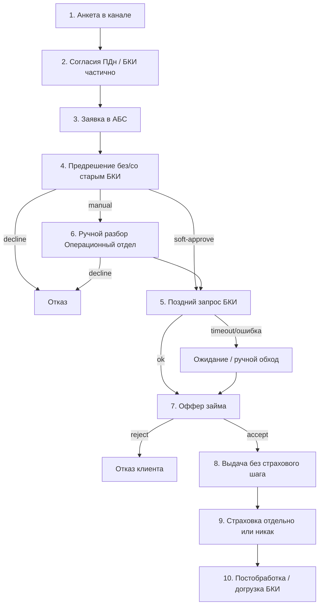

# AS-IS: процесс выдачи займа — Credit Journey

**Версия:** 1.0  
**Дата:** 2026-11-09  
**Согласовано:** Продуктовый отдел (бизнес-заказчик) при участии Отдела кредитных рисков, Операционного отдела (ручной разбор заявок), IT-отдела и Комплаенс и юридического отдела  
**Подготовил:** PM / BA  

**Опора:** [One-pager](../one-pager.md), [Стейкхолдеры и RACI](../stakeholders-raci.md)  
**Назначение:** зафиксировать текущий (разрозненный) процесс выдачи, чтобы контрастно описать целевой journey и обосновать MVP.

Описание текущего процесса по результатам предпроектного обследования: обобщённая модель фрагментированного digital journey онлайн-займа (не аудит отдельной организации).

---

## 1. Кратко об AS-IS

Клиент подаёт заявку в цифровом канале. Решение по займу часто принимается **до полноценной / своевременной** проверки БКИ или с ручными обходами. Страхование предлагается **поздно** (после одобрения или вне основного сценария выдачи) либо отдельным касанием. Ручной разбор и согласования тянут Time-to-Decision и Time-to-Cash; take-rate страховки и конверсия до оффера страдают.

### Допущения модели

- Один цифровой канал заявки + АБС как система учёта займа.
- БКИ вызывается не на каждом «счастливом» пути вовремя (поздний запрос, ручная подгрузка, повтор после правок).
- Страховой оффер не встроен в шаг выдачи как обязательный экран journey.
- Manual review — Операционный отдел; правила формально у Отдела кредитных рисков, но в AS-IS часто применяются несогласованно.
- Baseline KPI ещё не замерены — качественные боли согласованы с [one-pager](../one-pager.md).

---

## 2. Участники и системы

| Роль | Подразделение / сторона |
|------|-------------------------|
| Клиент | внешний |
| Канал заявки (UI/API) | IT-отдел |
| АБС / учёт займов | IT-отдел + Операционный отдел |
| Проверка БКИ | БКИ (внешний) + IT / иногда Операционный отдел вручную |
| Решение по займу | Отдел кредитных рисков (правила) + Операционный отдел (ручной разбор) |
| Страхование | Страховой партнёр + Продуктовый отдел (оффер вне потока) |
| Согласия / ПДн | Комплаенс и юридический отдел (шаблоны есть, момент сбора нестабилен) |

---

## 3. Пошаговый процесс AS-IS

| # | Шаг | Кто | Система | Результат / ветка |
|---|-----|-----|---------|-------------------|
| 1 | Клиент открывает заявку, вводит анкету | Клиент | Канал | Черновик / заявка создана |
| 2 | Согласие на ПДн (иногда без явного согласия на БКИ или «галочка позже») | Клиент / Комплаенс (шаблон) | Канал | Заявка может уйти дальше с неполным согласием |
| 3 | Заявка попадает в АБС; первичная проверка полноты | IT / Операционный отдел | АБС | Incomplete → дозапрос клиенту; иначе дальше |
| 4 | Предварительное решение «по своим правилам» (лимиты, стоп-факторы) **без или с устаревшим** БКИ | Отдел кредитных рисков / Операционный отдел | АБС, таблицы правил | Soft-approve / decline / в ручной разбор |
| 5 | При необходимости — **поздний** запрос в БКИ (после правок, по эскалации, пакетно) | IT / Операционный отдел | БКИ API или ручной кабинет | Ответ БКИ; таймаут → ждёт / ручной обход |
| 6 | Ручной разбор спорных кейсов | Операционный отдел | АБС + файлы/чаты | Approve / decline; очередь = задержка TTD |
| 7 | Клиенту показывают оффер займа (сумма, срок) | Канал / Продуктовый отдел | Канал, АБС | Accept / reject оффера займа |
| 8 | Выдача / зачисление **без** обязательного страхового шага | IT / АБС | АБС, платёжный контур | Деньги у клиента; TTC зависит от очередей и ручных шагов |
| 9 | Страхование: отдельный звонок, баннер, кабинет «после» или не предлагается | Продуктовый отдел / партнёр | Вне основного journey | Низкий take-rate; оффер не привязан к моменту выдачи |
| 10 | Постобработка: догрузка БКИ «для галочки», правки статусов | Операционный отдел / IT | АБС, БКИ | Расхождения данных; слабая аналитика причин отказа |

### Ветки отказа

- Decline на шаге 4/6 → клиенту отказ; причина не всегда кодируется единообразно.
- Клиент отвергает оффер займа (7) → воронка обрывается; страховка обычно не показывается.
- Таймаут/сбой БКИ (5) → заявка «висит» или идёт без актуальной КИ → риск и compliance-дыра.

---

## 4. Схема потока

---

## 5. Боли (связь с KPI)

| Боль AS-IS | Эффект | KPI |
|------------|--------|-----|
| БКИ не на критическом пути вовремя | решение «вслепую» или повторные циклы | Time-to-Decision ↑; proxy NPL / качество решения |
| Очередь ручного разбора | заявки ждут оператора | Time-to-Decision ↑, Time-to-Cash ↑ |
| Страховка вне шага выдачи | клиент уже «получил деньги» ментально | Take-rate страховки ↓ |
| Неполные / поздние согласия | риск compliance; переделки | Сдвиг релиза / ручные стопы |
| Причины отказа не унифицированы | нет прозрачной аналитики | % отказов по причинам — не контролируется |
| Сбой БКИ без fallback-политики | зависание или небезопасный обход | SLA БКИ; конверсия; риск |
| Разрыв канал ↔ АБС ↔ партнёры | ручные правки после выдачи | ошибки выдачи; доверие к данным |

Подробнее о направлениях метрик — в [one-pager](../one-pager.md) §3.

---

## 6. Разрыв с целевым процессом

AS-IS не обеспечивает:

- единый цифровой поток: согласие → БКИ → решение → оффер займа → оффер страховки → выдача;
- явные статусы approve / decline / manual review с правилами Отдела кредитных рисков;
- таймауты/ретраи БКИ и политику fallback;
- мониторинг SLA интеграций в момент выдачи;
- измеряемый baseline по KPI (после договорённости замеров).

Целевое состояние — в [TO-BE journey](to-be-loan-journey.md).

---

## 7. Допущения для TO-BE / BRD

1. В AS-IS страхование не блокирует выдачу; в целевом процессе оффер на шаге выдачи — **opt-in** (отказ от полиса не hard-stop).  
2. Доля заявок в manual review в AS-IS условно высокая; целевой % и критерии — в BRD / согласовании с Отделом кредитных рисков.  
3. Один БКИ-провайдер; мульти-БКИ — вне MVP.  
4. Канал = веб/API; отдельное мобильное приложение — вне scope.
