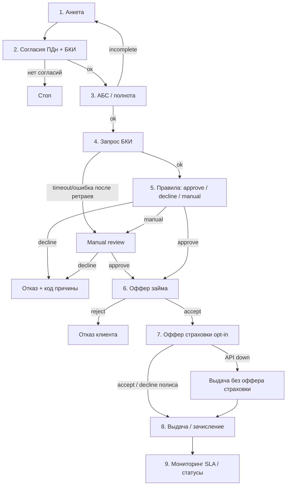

# TO-BE: journey выдачи займа — Credit Journey (MVP)

**Версия:** 1.0  
**Дата:** 2026-11-09  
**Согласовано:** Продуктовый отдел (бизнес-заказчик) при участии Отдела кредитных рисков, Операционного отдела (ручной разбор заявок), IT-отдела и Комплаенс и юридического отдела  
**Подготовил:** PM / BA  

**Опора:** [One-pager](../one-pager.md), [AS-IS](as-is-loan-process.md), [Стейкхолдеры и RACI](../stakeholders-raci.md)  
**Назначение:** целевой единый цифровой journey MVP; вход в детализацию требований ([BRD](../brd/brd-credit-journey.md)).

---

## 1. Цель TO-BE

Встроить проверку БКИ и оффер страхования в **один** цифровой journey: от заявки до зачисления — с прозрачным решением (approve / decline / manual review), контролируемым SLA интеграций и измеримым влиянием на KPI из [one-pager](../one-pager.md).

### Границы

| В MVP (Release 1) | Phase 2 | Out of scope |
|-------------------|---------|--------------|
| Согласие ПДн + БКИ до запроса | Расширенные правила скоринга / ручной разбор | ML-скоринг «с нуля» |
| БКИ на критическом пути решения | A/B офферов страхования | Мобильное приложение с нуля |
| Правила → approve / decline / manual review | Кэш / повторные политики БКИ | Полный коллекшен |
| Оффер страховки на шаге выдачи (opt-in) | Расширенная отчётность риск/продукт | Замена АБС целиком |
| Выдача при accept оффера займа | Компенсирующие сценарии частичных сбоев | Мульти-БКИ |
| Базовый мониторинг SLA интеграций | | |

---

## 2. Принятые допущения MVP

| # | Допущение | Статус |
|---|-----------|--------|
| 1 | Страховка на шаге выдачи — **opt-in**: отказ от полиса не блокирует выдачу займа | принято для MVP; тексты/UX — в BRD |
| 2 | Один БКИ-провайдер | принято |
| 3 | Канал = веб/API (не отдельное мобильное приложение) | принято |
| 4 | Доля manual review — гипотеза «ниже AS-IS за счёт правил + БКИ вовремя»; целевой % — в BRD после согласования с Отделом кредитных рисков | уточнить в BRD |
| 5 | При таймауте/сбое БКИ после ретраев → **manual review**, без approve при отсутствии актуального ответа БКИ | принято для MVP; лимиты очереди — в BRD |
| 6 | Сбой страхового API → выдача займа без оффера страховки + лог инцидента; выдача займа не стопится | принято для MVP |
| 7 | Коды причин отказа унифицированы (справочник) | принято; справочник — в BRD |

---

## 3. Happy path (MVP)

| # | Шаг | Кто | Система | Результат |
|---|-----|-----|---------|-----------|
| 1 | Клиент заполняет анкету займа | Клиент | Канал (UI/API) | Заявка создана |
| 2 | Явные согласия: обработка ПДн + запрос в БКИ | Клиент; шаблон — Комплаенс и юридический отдел | Канал | Без согласий — стоп; дальше нельзя |
| 3 | Заявка в АБС; проверка полноты полей | IT-отдел (авто) | АБС, Канал | Incomplete → дозапрос; иначе шаг 4 |
| 4 | Запрос в БКИ (на критическом пути) | IT-отдел | БКИ API | Ответ КИ / ошибка / таймаут |
| 5 | Интерпретация + правила решения | Отдел кредитных рисков (правила); IT (движок) | АБС / decision service | approve / decline / manual review |
| 6 | При approve — оффер займа (сумма, срок, условия) | Продуктовый отдел (условия); Канал | Канал, АБС | Accept / reject оффера |
| 7 | При accept — оффер страхования на том же шаге выдачи | Страховой партнёр; Продуктовый отдел | Страховой API, Канал | Accept полиса / decline полиса (opt-in) |
| 8 | Выдача / зачисление; фиксация статусов займа и (если есть) полиса | IT-отдел | АБС, платёжный контур | Деньги у клиента; Time-to-Cash |
| 9 | Мониторинг: статусы интеграций, SLA БКИ/страховки | IT-отдел; PM/BA (видимость) | Мониторинг / дашборд | Алерты; данные для KPI |

Шаг manual review (если сработал на 5) — см. альтернативы ниже; после approve оператором — продолжение с шага 6.

---

## 4. Ключевые альтернативы

| Ветка | Условие | Поведение MVP | KPI / риск |
|-------|---------|---------------|------------|
| Decline | Правила + БКИ → отказ | Клиенту отказ с кодом причины; без оффера займа/страховки | % отказов по причинам контролируем |
| Manual review | Правила / данные / таймаут БКИ после ретраев | Очередь Операционного отдела; решение approve/decline по регламенту Отдела кредитных рисков | TTD↑ на этой ветке; без approve без актуальной КИ / явного решения оператора |
| Reject оффера займа | Клиент не принимает условия | Конец journey; страховка не показывается | Conversion Application → Offer |
| Decline страховки | Клиент opt-out на шаге 7 | Выдача займа без полиса | Take-rate; TTC не блокируется |
| Таймаут / ошибка БКИ | Нет ответа после ретраев | → manual review (не auto-approve) | SLA БКИ; качество решения |
| Сбой страхового API | Оффер полиса недоступен | Сообщение «страховка временно недоступна» → выдача займа без оффера; инцидент в мониторинге | Take-rate↓ точечно; TTC сохранён |
| Incomplete анкета | Не хватает полей / согласий | Дозапрос в канале; БКИ не вызываем | Мусорные запросы БКИ↓ |

---

## 5. Схема потока

---

## 6. AS-IS → TO-BE

| AS-IS | TO-BE (MVP) | Зачем (KPI) |
|-------|-------------|-------------|
| БКИ поздно / вручную / постфактум | БКИ на критическом пути до решения | Time-to-Decision↓; качество решения; proxy NPL не ухудшить |
| Предрешение без актуальной КИ | Решение только после БКИ или явного manual review | Контролируемый риск |
| Согласия неполные / «потом» | Жёсткий гейт согласий до БКИ | Compliance; меньше переделок |
| Страховка после выдачи / отдельно | Оффер на шаге выдачи (opt-in) | Take-rate↑ |
| Сбой БКИ → зависание или небезопасный обход | Ретраи → manual review | SLA; нет approve без актуальной КИ |
| Сбой страховки не описан | Выдача займа без оффера + инцидент | Time-to-Cash не ломается |
| Причины отказа размыты | Справочник кодов причин | Аналитика % отказов |
| Постобработка и рассинхрон статусов | Статусы займа/полиса пишутся в момент выдачи + мониторинг | Целостность данных; меньше ручных правок |
| Manual review как норма | Manual review как исключение по правилам | TTD/TTC↓ на основной массе |

Подробнее о текущем процессе — [AS-IS](as-is-loan-process.md).

---

## 7. Связь с RACI (кратко)

- Правила решения — A: Отдел кредитных рисков; R: IT.
- Согласия — A: Комплаенс и юридический отдел.
- Manual review — R: Операционный отдел.
- Интеграции БКИ / страхование / АБС / канал — A/R: IT-отдел.
- Оффер и бизнес-приёмка — A: Продуктовый отдел.
- Статус и facilitation — A/R: PM/BA.

Детали — в [Стейкхолдеры и RACI](../stakeholders-raci.md).

---

## 8. Открытые решения для BRD

Зафиксировать в [BRD](../brd/brd-credit-journey.md):

1. Справочник кодов decline / manual reason.  
2. Политика ретраев и таймаутов БКИ (числа SLA).  
3. UX и юридические тексты opt-in страховки.  
4. Целевой % / критерии попадания в manual review.  
5. Минимальные поля мониторинга и алертов MVP.
